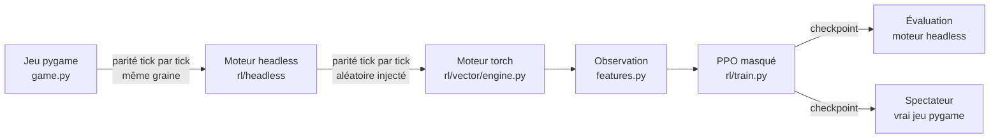

# Apprentissage par renforcement — Cuisto Bongo

Branche `reinforcementLearning`. But : entraîner une IA qui joue au vrai Cuisto
Bongo (mêmes règles, mêmes vagues, malus, bonus, boutique) sans règle de
décision écrite à la main, la comparer au hasard et à un bot scripté sur des
parties jamais vues, et pouvoir la regarder jouer dans le jeu d'origine.

La démarche reprend les leçons de Jackass-Parrow-RL : le verrou était le débit
de simulation. On passe donc directement à un moteur vectorisé sur GPU, avec des
tests de parité qui prouvent qu'il joue au même jeu.



## Installer

```powershell
uv sync --extra train          # torch + tensorboard (CPU sous Windows, CUDA sous Linux)
uv run pytest -q               # parité jeu/headless/torch, ~2 min
```

Le jeu lui-même n'est pas modifié : `uv run main.py` fonctionne comme avant.

## 1. Le moteur headless (`rl/headless`)

`engine.py` réécrit les règles de `game.py` et de ses managers en Python pur
(sans pygame), au tick fixe de 1/60 s. Il reproduit le jeu **exactement** :

* même ordre de mise à jour (gestionnaires, listes d'ennemis, projectiles,
  ramassage), mêmes formules flottantes que pygame (`sqrt(x*x+y*y)`, `lerp`
  = `a*(1-t)+b*t`, rectangles tronqués vers zéro) ;
* mêmes tirages aléatoires dans le même ordre : `Engine(seed)` rejoue la partie
  du vrai jeu après `random.seed(seed)`. Les modules purement cosmétiques
  (caméra, carte, particules, sons) ont leur propre générateur dans le test.

`python -m rl.parity --seeds 1 2 ... --decisions 20000` lance le vrai jeu
(pilote vidéo factice) et le moteur côte à côte, avec un bot qui envoie de
vraies touches au jeu, et compare **tout l'état à chaque tick**. Mesuré :
**plus de 300 000 ticks identiques sur 50 graines**, couvrant les 3 armes, les
6 malus, les 3 bonus (dont 15 explosions de bombes et 35 pilules), près de
200 morts, la boutique, la roulette et le passage des vagues.
`tests/test_headless_parity.py` en rejoue une partie à chaque `pytest`.

### Abstractions assumées

| Jeu | Moteur RL | Pourquoi |
| --- | --- | --- |
| Menu des recettes : E, flèches, E | Action « cuisiner la commande k » (four actif, ingrédients dans le sac) ; le menu reste ouvert jusqu'à la décision suivante, le joueur est immobile | Même effet, sans apprendre une interface |
| E près du four ouvre le menu | « Interagir » près du four ne fait rien | Dans le jeu, on ne peut pas attaquer au four |
| Boutique : flèches, E, « PASSER » | Décisions « acheter la carte k », sans durée ; sortie automatique quand rien n'est achetable | Le jeu impose d'acheter tant qu'une carte est abordable |
| Animation de mort (7 s), roulette (~6 s) | Instantanées, résultat exact | Le jeu est figé pendant ces phases |

Le mode spectateur (`rl/watch.py`) rejoue ces actions avec les vraies touches.

## 2. Le problème d'apprentissage

**Rythme.** Une décision est maintenue 6 ticks : **10 décisions par seconde**
de jeu (`--frame-skip`). Une vague (105 s) = 1 050 décisions.

**Actions (24, `rl/actions.py`)**, avec masque des actions invalides :

| Index | Action | Valide quand |
| --- | --- | --- |
| 0-8 | se déplacer (immobile + 8 directions) | en jeu |
| 9-17 | se déplacer + jouer de l'instrument | en jeu |
| 18-20 | cuisiner la commande 1, 2, 3 | four actif, ingrédients présents |
| 21-23 | acheter la carte 1, 2, 3 | boutique, carte abordable |

**Observation `CuistoBongo-v1` (577 valeurs, `rl/vector/features.py`).**
Égocentrique : positions relatives au joueur (÷1280, ÷800), listes triées par
distance avec indicateur de présence.

| Segment | Taille | Contenu |
| --- | --- | --- |
| Joueur | 24 | position sur la carte, PV, invulnérabilité, dash, direction, vitesse, recharge, sac (÷capacité, plein), arme |
| Contexte | 35 | phase, temps de vague, vague, objectif, pizzas faites/restantes, cadence nécessaire, dimension, four, portail, malus, bonus, pilule |
| Four | 5 | position relative, même dimension, à portée |
| Commandes | 3 × 13 | recette, temps restant, ingrédients manquants, cuisinable, points actuels |
| Boutique | 26 | 3 cartes (amélioration, prix, abordable) + niveau des 5 améliorations |
| Portails | 4 × 7 | position, distance, mobile, vitesse |
| Ennemis proches (même dimension) | 8 × 19 | position, type (calamar, géant, tomate), PV, état et vitesse des tomates, délais de tir |
| Tomates (toutes dimensions) | 6 × 6 | cibles pour la sauce |
| Projectiles | 8 × 7 | position, vitesse, taille, âge |
| Ressources | 2 × 6 × 5 | arbres (pâte) et cristaux (fromage) les plus proches, PV |
| Ingrédients au sol | 8 × 9 | type, ramassable dans la dimension courante, sac plein pour ce type |
| Bombes, pilules, notes de saxo | 24 + 12 + 8 | positions, dimension, mèche |

Comme pour Jackass-Parrow, c'est une observation **privilégiée** (positions et
délais exacts), pas l'image du jeu.

**Récompense (`rl/rewards.py`)**, hypothèses de départ :

| Événement | Poids | Raison |
| --- | --- | --- |
| Points de commande (une commande expirée retire ses points) | × 0,01 | le score du jeu |
| Pizza livrée | +1 | l'objectif de pizzas décide de la survie |
| Vague validée | +3 | |
| Game over (objectif raté) | −5 | |
| Mort | −1 | sac vidé, 30 s perdues |
| PV perdu | −0,01 | |

Aucune récompense pour survivre sans cuisiner (leçon de Jackass-Parrow : un
agent payé pour durer apprend à ne rien faire).

**Deux aides d'entraînement** (`rl/vector/game.py`), qui ne changent pas les règles :

* **Façonnage par potentiel** `γΦ(s′) − Φ(s)` (Ng et al., 1999 : politique
  optimale inchangée). Φ = 0,25 par ingrédient du sac encore demandé par une
  commande + 0,5 × (1 − distance au four / 4 000 px) quand une commande est
  prête (distance via le meilleur portail si le four est dans l'autre dimension).
* **Départs variés** : 50 % des parties d'entraînement commencent à une vague
  tirée entre 2 et 8, avec l'objectif et les ennemis de cette vague, des
  améliorations achetées avec les pizzas des vagues précédentes, une arme, un
  malus et un bonus au hasard. Les statistiques ne comptent que les parties
  commencées normalement.

## 3. Le choix du modèle

**Algorithme : PPO** (Schulman et al., 2017), actions discrètes masquées,
acteur et critique séparés, GAE.

* La simulation tourne sur le GPU avec des dizaines de milliers de parties :
  c'est le terrain de PPO (on-policy, gros lots, stable). DQN/Rainbow ou SAC
  discret demandent une mémoire de rejeu et profitent mal d'un tel débit ;
  IMPALA sert à répartir des acteurs sur plusieurs machines, inutile ici ;
  MuZero ou Dreamer apprennent un modèle du monde alors qu'on a le simulateur
  exact.
* Le masque d'actions rend « cuisiner » et « acheter » choisissables seulement
  quand c'est possible : l'agent n'explore pas des milliers d'actions sans effet.
* Pas de mémoire (LSTM) : l'observation contient tous les délais, l'état est
  markovien.

**Réseau : MLP 512-512-256 (SiLU)** pour l'acteur et pour le critique, avec
normalisation courante des observations sauvegardée dans le checkpoint. Un
encodeur d'entités par attention serait plus général, mais sur 577 valeurs
triées un MLP suffit et coûte peu face à la simulation. C'est une
piste d'amélioration si l'agent plafonne.

**Hyperparamètres par défaut (`rl/train.py`)** :

| Paramètre | Valeur | | Paramètre | Valeur |
| --- | --- | --- | --- | --- |
| γ | 0,998 (horizon ≈ 50 s) | | Époques / mini-lots | 4 / 8 |
| λ (GAE) | 0,95 | | Entropie | 0,01 |
| Clip | 0,2 | | Valeur | 0,5 |
| Taux d'apprentissage | 3·10⁻⁴ → 10 % | | Norme du gradient | 0,5 |
| Parties parallèles (GPU) | 16 384 | | Pas par mise à jour | 32 |
| Partie d'entraînement | 12 000 décisions (20 min) | | Précision simulation | float32 |

γ est plus élevé que pour Jackass-Parrow (0,995 à 15 décisions/s) : un cycle
« ingrédients → four » dure 20 à 40 s.

## 4. Le moteur vectorisé (`rl/vector/engine.py`)

Toutes les règles en opérations sur des tenseurs PyTorch : chaque variable est
un tableau de N parties ; les listes deviennent des emplacements fixes avec
masque (205 ressources, 75 ennemis, 48 projectiles…).

* **Ordre séquentiel conservé** : dans le jeu, chaque ennemi voit les nouvelles
  positions des précédents (séparation). Une boucle sur les emplacements
  d'ennemis le reproduit ; le reste est vectorisé.
* **Cartes de départ** : générées par le code de spawn du moteur headless
  (`rl/vector/layouts.py`), en cache dans `runs/cache/` (16 384 cartes par
  défaut). Roulette exacte par table pré-calculée.
* **Compatible graphe CUDA** : aucune synchronisation GPU → CPU dans un pas ;
  `GraphedStep` capture un pas complet et le rejoue en un appel.
* **Parité testée** (`tests/test_vector_engine.py`) : à chaque tick, l'état
  headless est copié dans le moteur torch, les deux avancent avec les **mêmes
  nombres aléatoires injectés**, tout l'état est comparé (float64, 10⁻⁹).
  Six bugs volontaires (rayon de séparation, invulnérabilité, capacité du
  sac, rayon des bombes…) ont tous été détectés.

Approximations : les cartes de départ supposent les portails à leur place
(après le malus « portails pompettes », le jeu fait apparaître la vague suivante
autour des portails déplacés) ; au-delà de 12 ennemis supplémentaires (vague
17), le moteur torch plafonne. Les mesures finales se font de toute façon sur
le moteur headless.

Débit mesuré sur CPU (1 024 parties, `python -m rl.vector.bench`) :
**≈ 3 600 décisions/s en float64, ≈ 3 950 en float32**. Le débit GPU reste à
mesurer : c'est la première chose à faire sur RunPod.

## 5. Entraîner sur RunPod

Image PyTorch (CUDA 12), puis :

```bash
git clone <dépôt> && cd gamejam4-cuistobongo && git checkout reinforcementLearning
pip install uv && uv sync --extra train
uv run pytest -q tests/test_vector_engine.py         # parité sur la machine
uv run python -m rl.vector.bench --device cuda --envs 16384 --decisions 50
# Court essai pour mesurer le débit réel et vérifier que les courbes bougent :
uv run python -m rl.train --output runs/essai --timesteps 50000000 --eval-every 10000000
# Entraînement complet :
uv run python -m rl.train --output runs/bongo-v1 --timesteps 2000000000 --seed 1
```

`--sim-dtype float64` donne la parité exacte mais est lent sur les GPU grand
public et sur l'A40 (double précision ×1/64) ; l'A100/H100 le supportent bien.
TensorBoard : `uv run tensorboard --logdir runs`. `--resume runs/x/final.pt`
reprend un entraînement (réseau, optimiseur, normalisations).

## 6. Évaluer et regarder

```powershell
# 40 parties inédites, jouées jusqu'au game over (max 21 min), moteur de référence :
uv run python -m rl.evaluate --player runs/bongo-v1/best.pt --games 40 --seed 700000 --output eval.json
uv run python -m rl.evaluate --player scripted --games 40 --seed 700000
uv run python -m rl.evaluate --player random --games 40 --seed 700000

# Regarder dans le vrai jeu (fenêtre, sons) ; pas de GPU nécessaire :
uv run python -m rl.watch --player runs/bongo-v1/best.pt
```

Spectateur : Espace pause, ↑/↓ vitesse ×1 à ×8, Tab actions déterministes ou
échantillonnées, N nouvelle partie, Échap quitter.

### Références mesurées (20 parties, graines 700000-700019)

| Joueur | Score | Vagues validées | Pizzas | Morts | Game over |
| --- | --- | --- | --- | --- | --- |
| Hasard | −417 ± 71 | 0 | 0 | 0,15 | 20 / 20 |
| Bot scripté (`rl/baselines.py`) | 621 ± 466 | 1,6 | 12,4 | 5,2 | 20 / 20 |

Le bot scripté est une stratégie gloutonne écrite à la main (commande la plus
urgente, ingrédient manquant, retour au four) ; il n'esquive pas. Il sert de
point de comparaison, jamais d'exemple pour l'IA.

## 7. Pour le rapport

À mesurer pendant et après l'entraînement, sur le modèle du rapport
Jackass-Parrow :

1. débits (CPU, GPU sans graphe, GPU avec graphe, entraînement complet) ;
2. courbe d'apprentissage (score, vagues, pizzas, morts des évaluations périodiques) ;
3. comparaison finale hasard / bot scripté / IA sur les mêmes 40 graines ;
4. comportement : temps par dimension, trajets portail ↔ four, choix des
   recettes et des améliorations, usage des bombes et pilules, esquive ;
5. coûts (durée, prix du GPU) et limites (observation privilégiée, une seule
   graine d'entraînement, pas d'ablation des aides).
